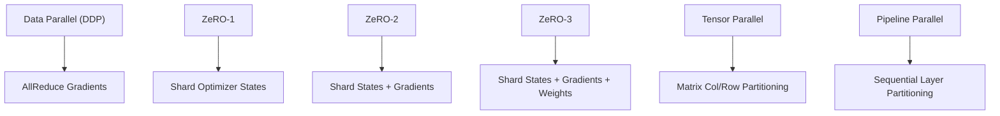

# Distributed Training Guide

SNEPPX-Alg provides production-grade distributed training primitives with NCCL hardware acceleration and deterministic CPU fallbacks.

## Architecture Overview



## DDP (Distributed Data Parallel)

DDP replicates model weights on every rank while feeding independent data mini-batches:

```python
from SneppX_ALG.interface_bindings import distributed
from SneppX_ALG import Tensor, F, nn, optim

# Initialize process group (CPU fallback or NCCL)
pg = distributed.init_process_group(world_size=4, rank=0, backend="gloo")

model = nn.Linear(64, 16)
opt = optim.Adam(model.parameters(), lr=1e-3)

# Inside training loop: all-reduce gradients before optimizer step
x = Tensor.randn((8, 64))
loss = model(x).sum()
loss.backward()

for p in model.parameters():
    if p.grad is not None:
        distributed.all_reduce(p.grad, op="mean")

opt.step()
opt.zero_grad()
```

## ZeRO (Zero Redundancy Optimizer) Stages

| Stage | What is Sharded | Memory Reduction | Communication Volume |
|---|---|---|---|
| **ZeRO-1** | Optimizer States ($m, v$) | $4\times$ reduction | Identical to standard DDP |
| **ZeRO-2** | Optimizer States + Gradients | $8\times$ reduction | Identical to standard DDP |
| **ZeRO-3** | Optimizer States + Gradients + Parameters | Linear with rank count | $+50\%$ communication overhead |

### Enabling ZeRO in Training Configuration

```yaml
# config/training/distributed.yaml
distributed:
  backend: nccl
  world_size: 8
  zero_stage: 2
  gradient_accumulation_steps: 4
  all_reduce_bucket_size_mb: 25
```

## Multi-Node Launching via CLI

```powershell
# Single-node multi-process
sneppx-train --config config/training/distributed.yaml --world-size 4 --rank 0

# Multi-node launcher invocation
sneppx-train --config config/training/distributed.yaml --master-addr 10.0.0.1 --master-port 29500 --world-size 16 --rank 0
```

## CPU Fallback for Local Development

When running without multiple GPUs or NCCL drivers, all collective operations (`all_reduce`, `broadcast`, `all_gather`) seamlessly execute as local identity operations, guaranteeing that code developed on a laptop runs unchanged on high-performance compute clusters.
